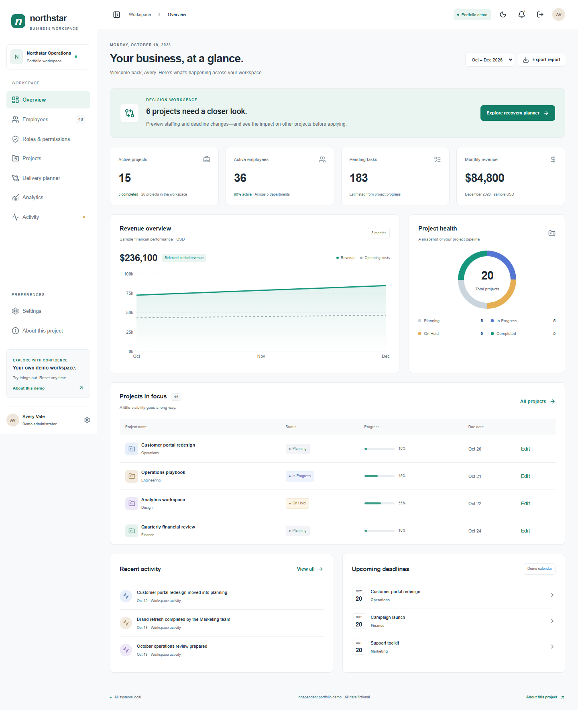
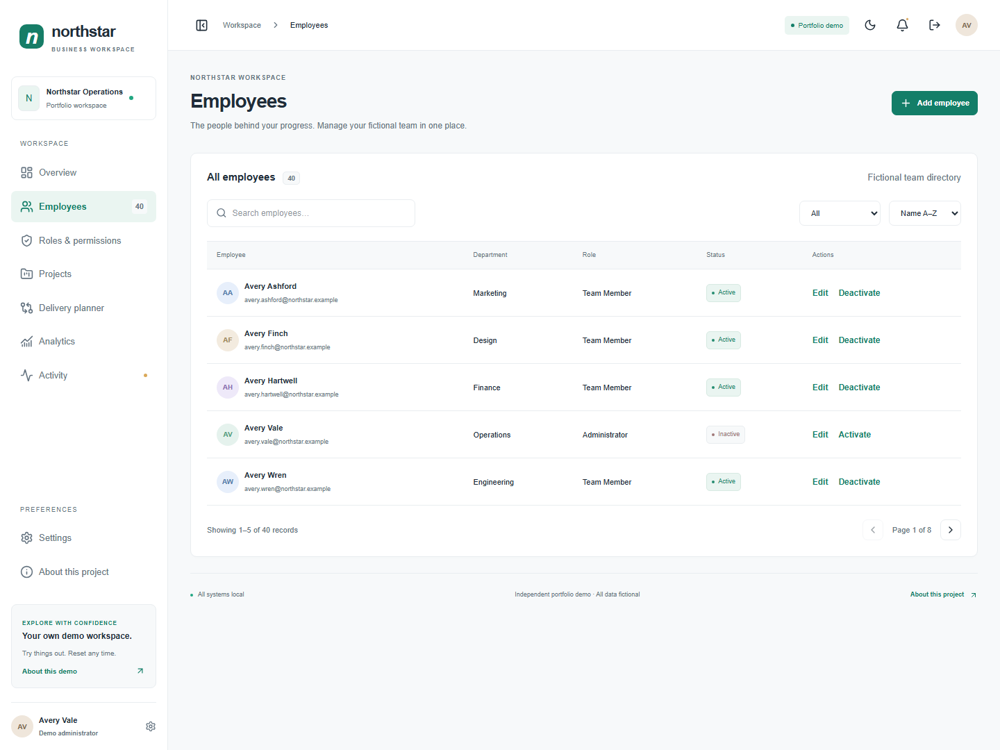
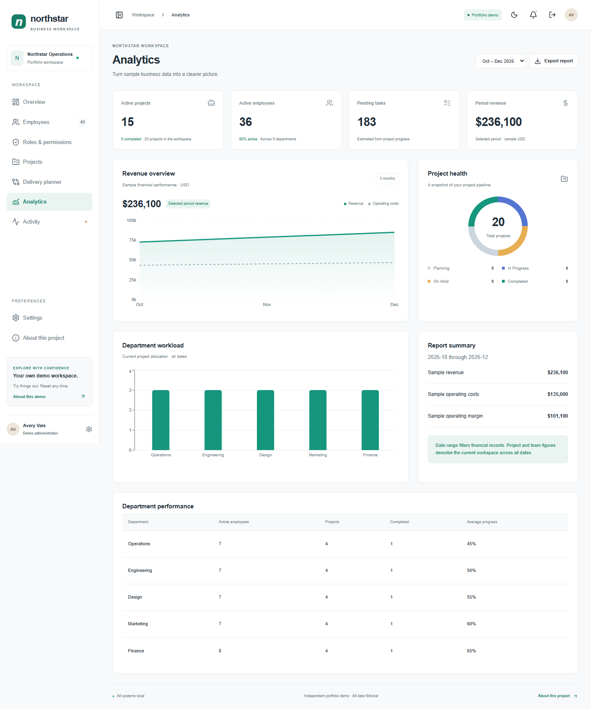
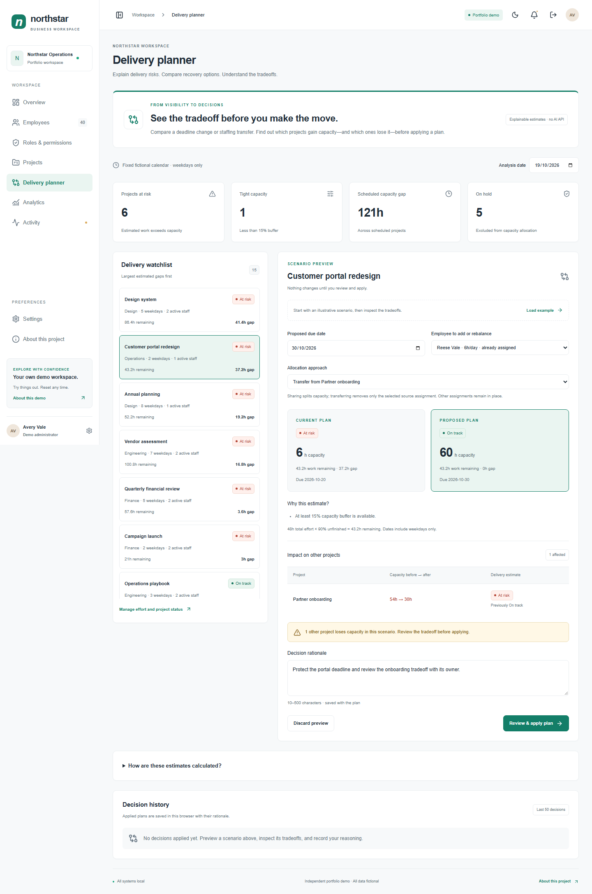

# Business Admin Dashboard

An independently designed, interactive portfolio demonstration of a business operations workspace. **Northstar Operations and every record are fictional. This is not client work.** No production backend, database, real authentication, or external API is connected. Entry and access controls are browser-side simulations.

## Features

- Public demo welcome screen and working exit/re-entry.
- Overview with derived project, employee, and task metrics, sample revenue, project health, activity, and deadlines.
- Employee search, sorting, filters, pagination, details, create/edit, role and department assignment, and activation confirmation.
- Project search, status and priority filters, sorting, details, create/edit, assignment, dates, progress, and status changes.
- Simulated role preview with editing controls and permission matrix.
- Financial date ranges, CSV download, department workload and performance.
- Read/unread notifications, local activity history, organization and display preferences, light/dark themes.
- Validated localStorage persistence, corrupt-data recovery, and confirmed reset.
- Keyboard accessible Radix dialogs and responsive mobile navigation.

## Screenshots

Actual application captures are stored in `docs/portfolio/screenshots/` after running the end-to-end suite.





## Stack

Next.js App Router, React, strict TypeScript, Tailwind CSS, Lucide, Recharts, React Hook Form, Zod, and Radix UI dialog primitives. ESLint, Prettier, Vitest, and Playwright support verification. Exact installed versions are pinned in `package-lock.json`; see `package.json` for the compatible ranges.

## Local setup

Use Node.js 22 LTS or newer and npm.

```sh
npm ci
npm run dev
```

Open http://localhost:3000 and select **Enter Demo**. No credentials are required.

```sh
npm run typecheck
npm run lint
npm test
npm run build
npx playwright install chromium
npm run test:e2e
npm run format
```

The E2E suite starts a dedicated static preview server on port 4173 itself. To inspect a production export manually, use `npm run start` after building. Playwright writes real desktop/mobile screenshots to the portfolio folder; failure traces appear under ignored `test-results/`.

Verification: strict TypeScript, ESLint, 15 unit tests, production static build, and five Chromium browser tests passed. See [executed checks and limitations](docs/VERIFICATION.md), including the remaining development-tool dependency advisory.

## Static deployment

`next.config.ts` uses `output: 'export'` and trailing slashes. `npm run build` produces `out/`. Cloudflare Pages configuration: build command `npm run build`, output `out`, production branch `main`. No server adapter, secrets, or paid resources are required. See [deployment guide](docs/DEPLOYMENT.md). Nothing is automatically published.

## Data and limitations

40 fictional employees, five departments, four roles, 20 projects, and 12 months of sample USD financial records initialize each browser. Inputs must contain fictional details only. Project and team metrics describe the current workspace across all dates; date filters affect financial records only. Pending tasks are estimates calculated from task counts and project progress. Financial fixtures are independent sample monthly records, not invoices generated by project edits. All 2026 months are a fixed demo reporting calendar, including illustrative future months.

Local edits survive reloads and exits in the same browser. The demo session uses sessionStorage; data uses versioned localStorage. Browsers can clear these at any time. Storage failures are reported, with edits retained in memory for the current visit. Corrupt persisted records fall back to the initial dataset. Reset replaces every local record and preference after confirmation.

Roles are a UI simulation and never a security boundary. The preview role controls employee/project editing and organization configuration; personal display preferences and reset remain available. Role assignment updates records, while preview selection is deliberately independent. No real messages, credentials, sensitive data, or shared collaboration are supported. Multi-tab concurrent writes are not coordinated. There is no backend migration implementation.

## Structure

```text
src/app/                 Static App Router entry and design system CSS
src/components/ui/       Accessible shared dialog
src/features/            Workspace modules, validated forms, lazy-loaded charts
src/data/                Deterministic fictional fixtures
src/lib/                 Zod models, browser storage, mock service layer, calculations
 tests/                  Unit and end-to-end coverage
 docs/portfolio/         Honest portfolio copy and actual captures
```

The workspace uses client-side module navigation within one static route; modules are not separate server pages. Feature forms, charts, fixtures, schemas, and data operations are separated from the workspace shell. See [architecture](docs/portfolio/ARCHITECTURE.md).

## Portfolio usage and repository practices

Copy the ready-to-edit assets in `docs/portfolio/` into your portfolio or proposals, with attribution to this independently built demo. Do not present it as paid client work or add fabricated testimonials. Review screenshots before sharing. Use Conventional Commits such as `feat: add interactive operations workspace`. Build outputs, dependencies, traces, and environment files are ignored. No environment configuration is needed.

## Signature feature: preview the cost of recovering a project

Open **Delivery planner**, select **Customer portal redesign**, and click **Load example**. The example extends its deadline and transfers Reese Vale from Partner onboarding. Compare the portal's closed capacity gap with the capacity lost by onboarding. Nothing changes until you enter a rationale, review the effects, and confirm.

Applied plans update affected project records together and preserve before/after snapshots in a local decision history. Undo restores those records only if they have not been edited since the plan was applied. This is the main portfolio demonstration: making the consequences of a business decision visible before taking action.

The planner uses editable total project effort and employee weekday capacity. Each person's capacity is shared across overlapping scheduled assignments, so hours are not double-counted. Open the calculation disclosure for thresholds and assumptions. These are deterministic estimates, not delivery guarantees or employee assessments. Skills, holidays, leave, dependencies, and automatic completion are outside the model.



See [the feature brief](docs/portfolio/DELIVERY_PLANNER.md) for positioning, a reproducible walkthrough, and related research-informed future ideas.
